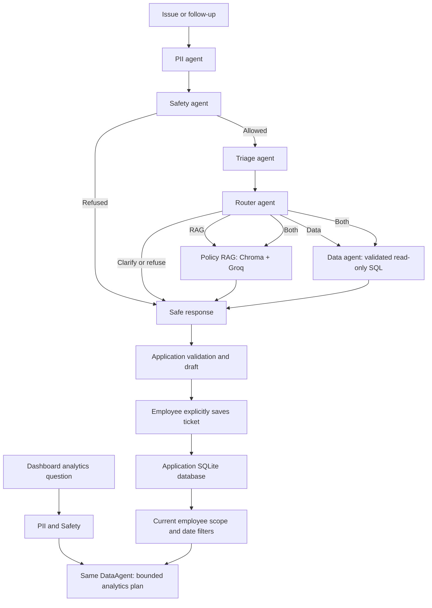

# StorePilot agent workflow

The workflow is connected to FastAPI through `app/services/copilot.py` and
`app/dependencies.py`. Agents remain usable without importing the HTTP application.



## Separation of concerns

- `guardrails/`: local normalization, PII redaction and safety decisions; no HTTP/database/model calls.
- `triage/`: structured interpretation, explicit-ID grounding and provisional confidence/priority.
- `router/`: selects RAG, Data, Both, clarification or refusal. Policy advice cannot use Data alone.
- `rag/`: Markdown ingestion, bounded chunks, local embeddings, Chroma retrieval, Groq generation,
  citation checks and output safety validation.
- `data/agent.py`: operational SQL planning and dashboard analytics on the same agent instance.
- `data/sql_tool.py`: SQL AST checks, table/column/function restrictions, read-only SQLite,
  row/execution caps, mandatory historical windows, current-level authorization for cases.
- `data/analytics.py`: bounded count/group/filter plan and deterministic aggregation; no arbitrary
  analytics SQL. Ticket text, identities and rows are not sent to the planning model.
- `workflow/graph.py`: guardrails, conditional dispatch, parallel specialists and one join.
- `workflow/response.py`: safe result composition; partial evidence requires human review.
- `app/services/copilot.py`: public ChatTurn adaptation, citation hashes, priority/refund rules,
  escalation and server-held draft construction.
- `app/main.py`: authentication, request validation, private persistence, retries and ticket commits.

The API injects verified caller identity. Validated selected store/SKU context takes precedence
over model extraction. The standalone CLI employee argument is a trusted local caller argument,
not authentication. No graph checkpointer is configured; do not enable external tracing of raw inputs.

## Setup and use

From `backend`:

```powershell
uv sync --locked
# Configure GROQ_API_KEY and JWT_SECRET in .env; use .env.example as the template.
uv run python -m app.agents.rag index
uv run python -m app.agents.workflow "Check SKU1001 stock at ST001 and advise replenishment"
uv run uvicorn app.main:app --reload --host 127.0.0.1 --port 8000
```

Index creation is an explicit setup action. It downloads local ONNX embeddings once and indexes
28 current chunks; policy edits require rebuilding. Retrieval and indexing need no Groq key.
Triage, routing, policy answer generation, SQL planning and analytics planning require Groq.
A missing key/provider/index produces unavailable/partial results, never a fabricated success.

`RetailWorkflow.ask(question, viewer_employee_id=..., entity_context=...)` returns a typed
`WorkflowResult`. Every graph invocation starts with PII then Safety; a refusal runs no models
or tools. The triage stage precedes routing because the existing router consumes structured triage.
Both specialists run in one parallel superstep and compose once. Input/model/retrieved/output
text is sanitized at its boundaries. Regex safeguards remain bounded prototype detection.

Operational data is the immutable retail snapshot. Timestamp windows are `(start,end]` in IST,
anchored to 10 October 2026 noon; receipts have calendar-date precision. Case queries are scoped
before aggregation using creator current level <= viewer current level. The database tool imposes
these boundaries even when generated SQL omits them. Missing inventory is unknown, not zero.

Dashboard analytics uses the same DataAgent's `analyze` method with tickets already scoped by
`app/reporting.py`. Live mode reads persisted Copilot tickets; historical mode reads imported
support cases. It supports counts by store, category, priority or status, optional status/priority
selection, plus the structured dashboard filters and private clarification threads.

The graph returns guidance. Explicit `POST /api/tickets` commits an eligible draft. It does not
approve refunds, notify people, execute transfers or change inventory. Partial/invalid/low-confidence
answers cannot produce a validated saveable draft. Urgent incidents still receive escalation guidance.

See [workflow and verification report](../../../../docs/COPILOT_WORKFLOW_AND_TESTS.md) for API
sequence, every endpoint, test commands, results and remaining legacy-suite limitations.
