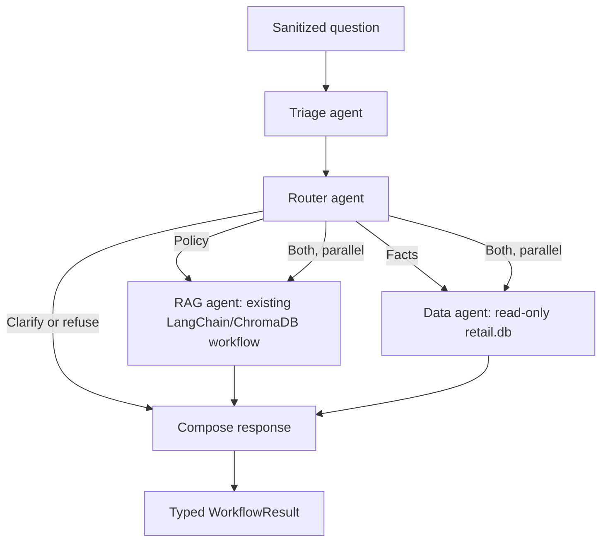

# StorePilot multi-agent workflow

One standalone LangGraph entry point coordinates triage, evidence routing, policy
RAG, and read-only retail data. **No HTTP endpoint is registered or connected.**
RAG continues to use LangChain and ChromaDB. The agents share the existing Groq
configuration in `backend/.env`.



The compiled graph has `triage_agent`, `router_agent`, `rag_agent`, `data_agent`,
and `compose` nodes. A single invocation runs the selected specialists. The
`both` route dispatches RAG and data in the same LangGraph superstep, using separate
state fields; their shared successor runs once after both finish. RAG reuses its
existing subgraph. Triage/router failures stop before specialist calls; a failure
in one specialist preserves useful results from the other as `partial`.

## Responsibilities and files

```text
app/agents/
  models.py                  Shared structured Groq model factory
  triage/
    schemas.py               Intent, category, provisional priority, explicit entities
    prompts.py               Triage instructions
    agent.py                 LangChain triage chain and extracted-ID validation
  router/
    schemas.py               Route and bounded allowlisted query plan
    prompts.py               Evidence selection instructions
    agent.py                 LangChain router and deterministic routing constraints
  rag/                       Existing separated LangChain + ChromaDB RAG modules
  data/
    schemas.py               Typed results, rows, provenance, and window metadata
    queries.py               Registered parameterized SQL and required filters
    repository.py            Read-only SQLite access and case visibility checks
    agent.py                 Executes the validated plan and formats factual evidence
  workflow/
    config.py                Database path, event anchor, limits, RAG/Groq configuration
    input.py                 Local input minimization and size validation
    schemas.py               Shared graph state and result contracts
    nodes.py                 Agent adapters and failure handling
    graph.py                 LangGraph topology and conditional parallel dispatch
    response.py              Deterministic response composition
    service.py               Public facade and dependency composition
    __main__.py              Standalone CLI
```

Triage uses Groq to understand the question, extracting only IDs present in the
input. Its structured output goes to a separate Groq router chain. The router
chooses `rag`, `data`, or `both`, plus `clarify`/`refuse` when appropriate, and a
bounded query plan. It cannot produce SQL. Guidance cannot bypass policy retrieval;
urgent incidents get policy guidance before optional clarification.

The router also produces a focused `policy_question` for RAG; operational lookups
stay in the data plan. The default GPT-OSS model uses Groq native strict JSON-schema
outputs for all model agents. Other configured Groq models use function calling
and local schema validation; provider/model failures are reported without raw details.

The data agent is deterministic: it executes the router's validated plan against
registered SQL templates, with no arbitrary model-generated SQL or write access.
The response node combines the validated RAG answer and structured data evidence
without another model inventing a causal explanation. Triage priority is explicitly
provisional; this is not the full deterministic priority/refund/ticket service.

## Setup and run

From `backend/`, with `GROQ_API_KEY` in the existing `.env`:

```powershell
uv sync --locked
uv run python -m app.agents.rag index
uv run python -m app.agents.workflow "When does a refund need manager approval?"
uv run python -m app.agents.workflow "Show inventory for SKU1001 at ST001"
uv run python -m app.agents.workflow "Check stock and receipts for SKU1001 at ST001 and explain replenishment policy"
uv run python -m app.agents.workflow "Count historical cases for ST001 in the last 24 hours" --employee-id E0004
```

Alternatively use `.venv/Scripts/python.exe -m ...` in place of `uv run python`
after installing dependencies. The existing `rag index/retrieve/ask` commands
and Python RAG facade remain available independently.

`DATABASE_PATH` defaults to `database/retail.db`; `DATA_ROW_LIMIT` defaults to 50
and is capped at 100; `EVENT_ANCHOR` defaults to `2026-10-10T12:00:00+05:30`.
Time windows operate on the supplied historical snapshot, never live availability.
Indexing is an explicit setup step, never silently performed on workflow startup.

```python
from app.agents.workflow import create_workflow

workflow = create_workflow()
result = workflow.ask("Check SKU1001 at ST001 and explain replenishment policy")
print(result.routing.route)
print(result.answer)
print(result.model_dump())

# Employee identity must come from a trusted caller, never the question/model.
result = workflow.ask("Count historical cases in the last 24 hours", viewer_employee_id="E0004")
```

For graph composition, `workflow.graph` supports LangGraph invocation/streaming.
Its input is `{"question": sanitized_text, "viewer_employee_id": trusted_id_or_none}`.
Prefer `workflow.ask` for ordinary callers: it sanitizes before graph entry so raw
input is not exposed to graph callbacks. There is no checkpointer or chat history.
Injected `WorkflowNodes` dependencies support offline tests and alternate models.

## Supported data plans

| Query | Required filters (at least one) | Result |
| --- | --- | --- |
| inventory | store_id or sku | On-hand/system quantity, reorder point, count date |
| product | sku | Product name/category, list price, demand/warranty fields |
| store | store_id | Store location, register count, nearby store ID |
| receipts | store_id, sku, or vendor_id | Shipment quantities, receipt vendor, fill ratio |
| vendor | vendor_id or sku | Vendor fill/on-time rates and effective date |
| returns | store_id or sku | Bounded return records, dates, reasons, status |
| case_summary | Trusted employee identity; optional store_id/sku | Case counts by category/status |

The router can request up to three queries. Unknown IDs produce no matching data;
missing required filters request clarification rather than an unrestricted scan.
Case counts are scoped **before aggregation** using the current creator's escalation
level <= the current viewer's level. Missing/unknown viewer identity fails closed.
No employee names, free-text support cases, historical root-cause hints, or private
conversations are returned. The CLI employee argument is trusted local development
context, not authentication; future API integration must supply verified identity.

Rolling windows are `(anchor - lookback_days, anchor]`, 1–365 whole days. Timestamped
records use IST; date-only receipts use calendar-date boundaries and report this
precision explicitly. Row lists are capped and marked `truncated`; case totals
aggregate the entire authorized scope. Vendor lookup by SKU uses the product's
current vendor, while receipt evidence uses the actual shipment vendor.

## Output and limits

`WorkflowResult` includes status, answer, triage, routing, policy citations/results,
data rows/provenance, limitations, and a human-review flag. Statuses distinguish
answered, partial, clarification, refusal, unavailable, and insufficient evidence.
No branch approves refunds, creates tickets, executes transfers, or sends messages.

Input minimization masks common email, phone/card-number, and labeled secret patterns
before model calls. Restricted intent is classified in triage and refused by the
router. This is a prototype boundary, not a complete PII/safety classifier; do not
put private data in the CLI. Full authentication, persistent conversation follow-ups,
ticket writes, richer analytics, and complete deterministic business rules remain
separate work. Confidence is a provisional triage estimate, not a correctness score.

## Verify

```powershell
uv run pytest tests/test_workflow.py tests/test_rag.py tests/test_api.py
uv run ruff check app/agents tests/test_workflow.py tests/test_rag.py
```

The workflow tests use injected LangChain models and real temporary SQLite data:
all routes, parallel join, missing filters, partial failures, source grounding,
current employee-level visibility, time boundaries, row limits, and read-only access.

Graph reference: [LangGraph graph API](https://docs.langchain.com/oss/python/langgraph/graph-api).
