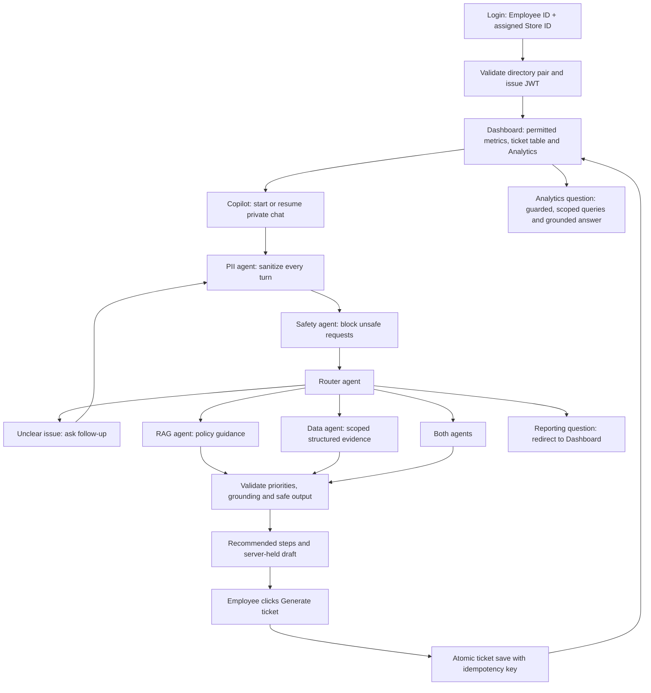

# StorePilot: application flow, API endpoints and tests

This guide accompanies the executable TDD tests. The contract is [openapi.json](../openapi.json); most routes and all agents are still proposed. Only test assets and this explanation were added in this phase. Existing design documents describe the earlier planning phase; [README.md](README.md) records the current test setup and results.

## What the employee sees

An employee enters **Employee ID** and **Store ID**, then reaches **Dashboard**. Dashboard combines ticket totals, distributions, a filtered ticket table and an Analytics question box. **Copilot** is the second navigation destination: a private chatbot with follow-up questions, recommended steps, policy citations and a ticket draft card. Clicking **Generate ticket** saves the report and displays a ticket receipt. There is no separate Overview, Analytics or Evaluation page.



Safety refusal ends the ordinary retrieval/query path. A clarification or unavailable service must not produce a saveable draft. A ticket may record that approval is needed; saving it does not approve a refund, notify a team or execute an operational action.

## Request flow and authority

Except for health and login, requests send `Authorization: Bearer <JWT>`. The server validates signature, allowed algorithm, issuer, audience, timestamps and the registered, unrevoked session. It verifies the employee's current store assignment and loads their current escalation level from the directory. The browser and token cannot set ticket authority.

Ticket reads use **creator's current level ≤ viewer's current level**. Viewer levels 1/2/3/4 see creators at levels 1 / 1–2 / 1–3 / 1–4. The rule runs before pagination, aggregation, snippets and model context. Store and other filters can only narrow this scope. Conversations, drafts and Analytics threads are owner-only. Ticket visibility does not permit editing a peer's ticket.

```mermaid
sequenceDiagram
    participant UI as React UI
    participant API as FastAPI
    participant Graph as Guardrails / LangGraph
    participant SQL as SQLite
    UI->>API: POST /api/auth/login {employee_id, store_id}
    API->>SQL: Verify employee assignment; register session
    API-->>UI: 200 JWT + current employee context
    UI->>API: GET /api/dashboard and GET /api/tickets + Bearer JWT
    API->>SQL: Current-level scope, filters, full totals and page
    API-->>UI: Permitted dashboard and ticket rows
    UI->>API: POST /api/conversations
    API-->>UI: 201 private conversation ID
    UI->>API: POST /api/conversations/{id}/messages + client_message_id
    API->>Graph: Sanitized owner context and issue
    Graph-->>API: Clarification, refusal or grounded draft
    API->>SQL: Persist sanitized turn and draft revision
    API-->>UI: 200 typed ChatTurn
    UI->>API: POST /api/tickets + draft revision + Idempotency-Key
    API->>SQL: One transaction: ticket, children, event, receipt
    API-->>UI: 201 ticket, or 200 committed retry
    UI->>API: GET /api/dashboard and GET /api/tickets
    API-->>UI: Updated authorized workload
```

## Every API endpoint

### 1. GET /api/health — public readiness

Used to tell the UI whether source DB, application DB, chat and retrieval are available. No body or JWT. Returns **200 `Health`** when ready/degraded; **503 `Health`** when required data services are unavailable. No ticket or employee data belongs in this response. Checking a missing database must not create it.

Tests: `test_api.py` checks the response schema, unavailable source DB, no data leakage and unchanged source inputs. This intentionally rejects the starter health payload, which uses the old shape.

### 2. POST /api/auth/login — employee identity lookup

Public JSON body: `{"employee_id":"E9001","store_id":"ST001"}` in the test fixture. Both must match an actual directory assignment. **200 `LoginResponse`** contains signed JWT, token expiry and `EmployeeContext`. Bad employee/store pairs return a generic **401**; malformed IDs or extra authority fields return **422**. Repeated abuse may receive **429**.

Tests: `test_auth.py` independently verifies the returned signature and claims, the 30-minute lifetime, wrong pairs, invalid shapes and rejected client role/level overrides. The fixture IDs are synthetic and do not add employees to the source DB.

### 3. POST /api/auth/logout — revoke this session

JWT required; no body. Server revokes the session and returns **204**, with no JSON body. Replaying that JWT must fail with **401**. The UI clears private conversation state and token storage.

Tests: `test_logout_revokes_session` and the browser logout journey. Server revocation and browser cleanup are separate assertions.

### 4. GET /api/me — current employee context

JWT required; no body. **200 `EmployeeContext`** returns employee ID, assigned store, role and current level. Fetch these values from the directory. A reassigned store invalidates the old session; a level change affects the next request without trusting a stale token claim.

Tests: `test_context_and_policies.py` verifies the profile; `test_auth.py` verifies level changes, assignment changes and adversarial JWTs.

### 5. GET /api/stores — affected-location options

JWT required; no body. **200 `StoreList`** returns store and warehouse choices used by issue context and dashboard filters. Selecting another affected store does not change the employee's identity or expand ticket visibility.

Tests: `test_locations_include_store_and_warehouse_options` verifies known stores/warehouse and unique IDs. `test_visibility.py` verifies filters cannot widen access.

### 6. POST /api/conversations — start a private Copilot chat

JWT required. Body is `{}` or `{"affected_store_id":"ST003"}`. The server sets the owner from authenticated identity. **201 `Conversation`** returns the conversation ID and sanitized history. This endpoint creates a chat, not a ticket.

Tests: `create_draft` in `test_chat_and_creation.py` exercises this real route as the start of ticket generation; schema validation checks the response. The browser follow-up journey checks the visible chat flow.

### 7. GET /api/conversations/{conversation_id} — resume own chat

JWT and UUID path parameter required. **200 `Conversation`** returns sanitized messages for the owner. Missing and another employee's conversation return **404**, even if the viewer has a higher level.

Tests: `test_private_chat_is_not_exposed_to_higher_level_employee`; HTTP chat tests inspect stored sanitized messages, and the browser logout test verifies private state is cleared.

### 8. POST /api/conversations/{conversation_id}/messages — guarded chat turn

JWT required. Body includes `content`, UUID `client_message_id`, and optional `context` with affected store, SKU or register. Each turn, including follow-ups, goes through PII → Safety → Router → RAG/Data/Both → final validation. **200 `ChatTurn`** is typed: clarification, recommendation, refusal, dashboard redirect, unsupported or unavailable. It carries safe assistant text, recommendations, citations/evidence, guardrail flags and optional draft.

Clarification has a focused question and no saveable ticket. A reporting question goes to Dashboard. The same message ID identifies a retry, not a second logical turn. Changed reused content is a **409** contract condition. Service unavailability/timeouts use **503/504**, rather than invented answers.

Tests: `test_chat_and_creation.py` checks HTTP persistence, PII handling and same-message retries. `test_pipeline.py` directly exercises follow-ups, guardrail order, route selection, policy/data grounding, confidence, priorities, approval thresholds, injected evidence and failures. Its model/retrieval doubles supply inputs; the future production workflow must perform the rules.

### 9. GET /api/ticket-drafts/{draft_id} — inspect proposed ticket

JWT and UUID required. **200 `Draft`** returns the server-held revision, title/description, affected location, category/priority, confidence, steps, sources, review/approval flags, `generation_allowed` and expiry. The browser must respect `generation_allowed`; the backend rechecks validity when saving. Another owner's draft returns **404**.

Tests: `test_draft_read_is_owner_only_and_matches_chat_revision` and expired/non-owner generation tests. Pipeline tests require refusal, unclear or unavailable outcomes to block generation.

### 10. POST /api/tickets — Generate ticket

JWT plus required `Idempotency-Key` header. Body is only `{"draft_id":"<UUID>","draft_revision":1}`. The server supplies creator, level, priority and validated content. One transaction commits ticket, steps, citations/evidence, creation event and retry receipt into the application DB. **201 `TicketCreated`** means a new committed ticket; an identical committed retry returns **200**, the same ticket ID and `idempotent_replay=true`.

**409** covers conflicting retry/stale draft/duplicate draft. A non-owner draft is **404**. Extra creator/priority fields are **422**. A failed child insert must roll back everything and return a safe failure, with no success receipt.

Tests: `test_chat_and_creation.py` checks structured persistence, identical/different/concurrent retries, duplicate draft protection, transaction rollback, expired/foreign drafts, rejected authority fields and unchanged retail snapshot. The browser checks success receipt and retry key reuse.

### 11. GET /api/tickets — permitted ticket table

JWT required. Query supports common filters below, plus `search`, `limit` and `offset`. **200 `TicketList`** contains scoped rows, full matching `total`, pagination and resolved context. Pagination does not change totals. Search values are data, never executable SQL. Inaccessible rows must not affect counts or snippets.

Tests: `test_visibility.py` checks all four viewers' totals/pagination, search and store filters, current level changes and missing creators. `test_analytics.py` checks SQL injection, time boundaries and live data.

### 12. GET /api/tickets/{ticket_id} — report detail

JWT required. **200 `TicketDetail`** returns permitted ticket facts, recommended steps, citations, evidence, escalation and events. Missing and hidden tickets both return **404**. Related-ticket evidence must be checked again against the current viewer's scope.

Tests: all **16 viewer/creator level combinations**, identical hidden/missing errors, live creator-level changes and stored related-evidence suppression in `test_visibility.py`; creation tests check saved detail matches the receipt.

### 13. PATCH /api/tickets/{ticket_id}/status — creator's lifecycle action

JWT required. Body includes `status`, `expected_version` and optional `reason`. Allowed transitions: Open → In Progress/Closed; In Progress → Open/Closed; Closed → Open, with a reason. A successful **200 `TicketDetail`** has updated status/version, appropriate closure time and a recorded event. Updates must be atomic.

A visible peer ticket is **403** for mutation; a hidden ticket is **404**. Stale versions or same-state/invalid transitions are **409**. Reopen without a reason is **422**.

Tests: `test_ticket_lifecycle.py` parameterizes all five allowed transitions and verifies events/version, visible-peer denial, hidden denial, stale/no-op writes and reopen reason.

### 14. GET /api/dashboard — combined overview and analytics data

JWT required; common query filters. **200 `Dashboard`** returns total/Open/In Progress/Closed/unresolved/P1/P2 metrics, priority/category/store distributions, data revision and resolved query context. Scope is identical to the ticket table and applied before calculation. Unresolved means Open or In Progress.

Tests: each viewer must receive **2/4/6/8 total** and **1/2/3/4 unresolved** in the base fixture. Distribution sums, current-level changes and the regression against an unprotected starter dashboard are checked in `test_visibility.py` and `test_api.py`.

### 15. POST /api/dashboard/analytics — ask the dashboard agent

JWT required. Body contains `question`, optional `filters`, and optional `analytics_thread_id` for a private follow-up. The Analytics agent receives guarded input and authorized evidence from approved parameterized query templates. **200 `AnalyticsResponse`** includes answer/result type, table columns/rows, full `total_rows`, `truncated`, query IDs, citations/evidence, limitations and resolved scope/time/source versions. Maximum response rows is 200; aggregate calculations still use the full permitted dataset.

It may clarify or refuse safely. It does not generate an incident ticket. Someone else's Analytics thread is **404**. Malformed filters are **422**; backend failures/timeouts are **503/504**.

Tests: `test_analytics.py` checks per-viewer grouped counts, no hidden evidence in model context/output, owner-only threads, time semantics and SQL parameterization. The browser checks the integrated question box and that asking Analytics makes zero ticket saves.

### 16. GET /api/policies/{section_id} — open a citation

JWT required. The section ID is a known catalog identifier, such as `02_pos_pricing_returns_policy.md#pos-card-reader-runbook`, URL-encoded in the path. **200 `PolicySection`** returns section ID, filename, heading, source text and source hash. Resolve a catalog entry; do not interpret the request as an arbitrary file path. Unknown sections return safe **404**.

Tests: `test_context_and_policies.py` checks a section from each of the five policy files, exact text/provenance and unknown-section errors. `test_pipeline.py` rejects invented citation IDs.

## Shared filter and error semantics

`data_mode`: live or historical_snapshot. `window`: last24h/last7d/last30d/all. Other filters: store_id, sku, status, priority, category. Explicit `start` and `end` must be supplied together and cannot be mixed with a preset. Time interval is **(start, end]**. Historical mode uses the fixed `2026-10-10T12:00:00+05:30` anchor; live mode uses server time and persisted application tickets. Future rows are excluded. Responses explain the resolved scope/window/source versions.

Error bodies use `code`, safe `message` and `request_id`. **401** invalid authentication; **403** visible-but-forbidden mutation; **404** absent/inaccessible resource; **409** conflict; **422** input validation; **429** rate limit with Retry-After; **503** unavailable dependency; **504** bounded timeout. Do not return raw prompts, secrets, internal SQL or hidden record details.

## Test execution flow

1. Validate the OpenAPI document, schemas, examples and declared security.
2. Copy the retail snapshot into a temporary fixture; create a separate test application DB and four synthetic employees.
3. Invoke real HTTP routes with independently signed valid/adversarial tokens. Inspect returned schemas and actual SQLite rows, not just response text.
4. Invoke the future production graph with scripted model/retrieval/data collaborators. Assert guardrails and deterministic business rules.
5. Invoke the future backend evaluator with intentionally wrong predictions. Assert labels are withheld from inference, denominators are real, exports match the supplied schema, and evaluation writes no tickets.
6. Run browser journeys against Vite with scripted HTTP responses. Assert UI behaviour and retry handling; backend tests separately prove authorization/persistence.

[TEST_CATALOG.md](TEST_CATALOG.md) identifies every collected backend case and its baseline result. [README.md](README.md) explains run commands, fixtures, planned production seams and remaining coverage. [Frontend test guide](../../frontend/tests/README.md) explains each browser journey.
