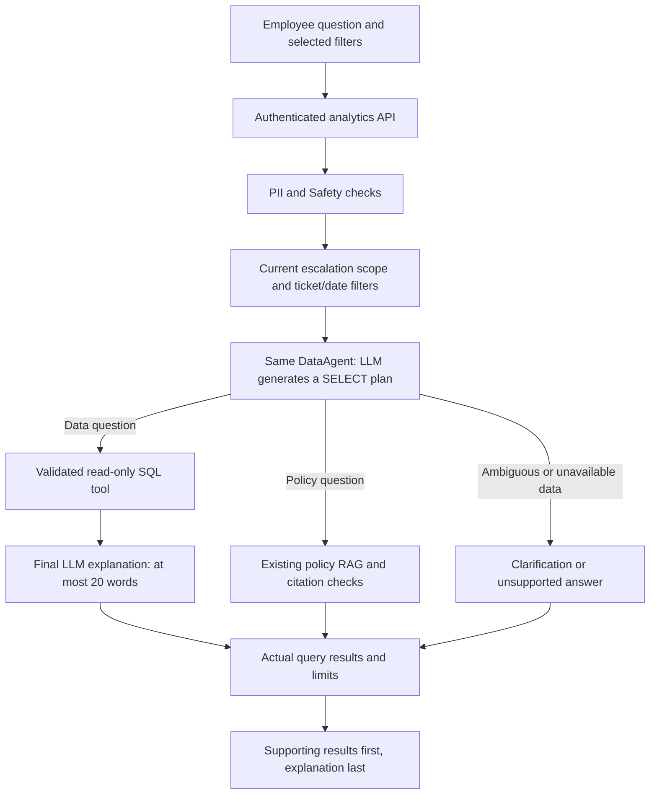

# StorePilot analytics: SQL planning → tool → brief explanation

The Analytics/Query page answers natural-language questions about the available retail data.
It defaults to all ticket statuses and all dates; the Dashboard still defaults to Open tickets.
Employees can ask about stock, products, vendors, deliveries, returns, ticket patterns and
escalation rules. Procedure questions use the existing policy RAG agent. Data that is absent,
such as sales transactions/profit, is reported as unsupported rather than invented.

## API and execution

`POST /api/dashboard/analytics` accepts `question`, dashboard `filters`, and an optional
private `analytics_thread_id`. The API loads matching tickets using the same current-directory
visibility rule as the Dashboard: creator level ≤ viewer level. Follow-up threads belong only
to the authenticated employee. Analytics creates no incident ticket and makes no operational changes.

The configured LLM uses `SqlAnalyticsPlan` to produce a single SQLite SELECT plus explicit named
parameter bindings. Simple omitted store/SKU/vendor bindings can be grounded in the question or
trusted filters. The `execute_analytics_sql` LangChain tool parses and validates the SQL, then
executes it. One schema/error-only correction attempt is allowed; results and private rows are
never sent back to the planning model. The existing count-plan representation is retained only
for older collaborators; new production data plans always generate SQL.

After successful execution, a separate LLM receives only the verified public results, bindings,
filters, coverage counts and limits. It writes the final explanation in at most 20 words.
Row-reference, numeric-claim, PII and safety checks validate that explanation. Invalid or unavailable
narration preserves the verified results with a brief fallback and an explicit limitation.
Coverage counts distinguish an empty matching result from missing source data: ST004 has inventory
records but no zero-stock products. Replenishment includes stock at or below the reorder point.

The tool queries an isolated memory database containing only approved columns from the read-only
retail source and `visible_tickets` metadata supplied by the API. The memory database is temporary;
it does not replace the persistent ticket database. Raw `support_cases`, `employee_master`,
application records, issue descriptions, identities and system tables are unavailable to generated
SQL. Writes, additional statements, comments, extensions, unrestricted stars and unsupported
functions are rejected. SQLite also enforces query-only mode and an execution budget.

Selected store/SKU filters are applied before SQL execution. Selected date windows also bound
deliveries/returns, capped at the fixed retail snapshot anchor. Ticket filters and data mode apply
to `visible_tickets`. Ticket dates are normalized to Asia/Kolkata for daily trends. Stock and vendor
figures are snapshot facts, not live operational feeds. Historical ticket visibility remains capped
at the imported snapshot time; new tickets remain in persistent application storage.

The response retains the existing OpenAPI shape: readable `answer`, typed `columns` and actual
`rows`, `intent`, source `evidence`, policy `citations`, `limitations` and `truncated`.
SQL results default to a maximum of 50 rows (configurable up to 100). Aggregate counts run before
the result cap. `total_rows` is the returned result-row count; it does not claim full cardinality
when `truncated` is true. The frontend presents supporting rows as readable text, with sources
and scope details in expandable supporting results. The brief explanation appears last.

## Examples

- What is the most frequent issue in store ST004?
- Show me the number of unresolved tickets.
- Which products need replenishment in ST004?
- Which three vendors have the lowest on-time delivery rate?
- How many returned products are there by reason?
- Show ticket counts by day for ST004.
- Explain the return policy.

## Tests and verification

`backend/tests/test_analytics.py` runs real SQL against the project data with offline structured
planning responses. It covers issue ranking, operational joins, stock, vendors, products,
deliveries, returns, escalation rules, trends, forced store/SKU/time filters, output truncation,
no-data answers, query execution limits, parameter grounding, one correction attempt, local
calendar dates, API contract/current-level scope, policy citations and private-data/write attacks.
Existing API tests continue to verify every creator/viewer level and dynamic directory changes.

`backend/tests/test_analytics_answers.py` checks the final explanation, the 20-word cap, empty
stock versus missing inventory, private-data exclusion, invalid references, invented numeric
claims, unsafe output, provider failures, truncation and preservation of verified results.

The browser integration suite verifies a most-frequent-issue question and replenishment query
through the real API/tool, confirms readable supporting results and a final brief explanation,
checks an empty-stock answer, and verifies no ticket is generated.
Other journeys retain ticket persistence, Open-only Dashboard behavior, own-store reporting,
clarification, private threads, retry receipts and logout checks.

Live model checks are separate from deterministic tests. The configured provider successfully
generated and executed issue rankings, unresolved counts, replenishment, vendor rankings,
return summaries and daily ticket trends. Repeated live checks also encountered a provider rate
limit; model quota/availability remains a dependency and is not covered by offline passing tests.
