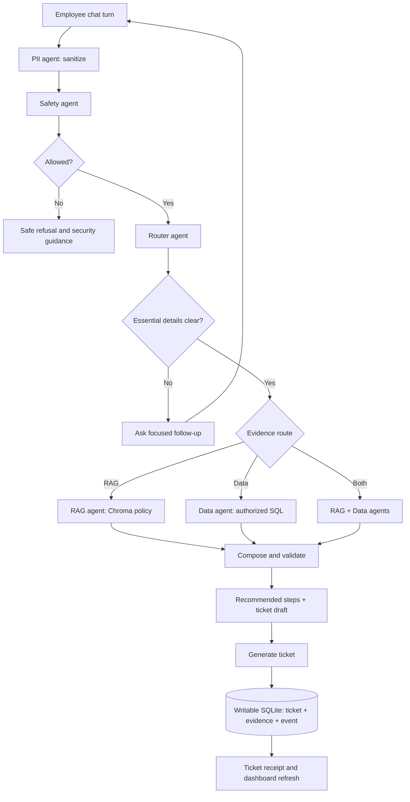
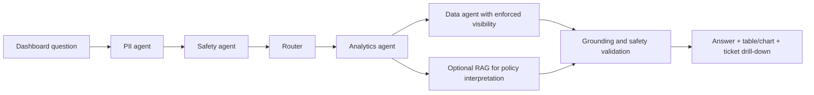

# StorePilot — Application Flow

Version: 2.2 | Status: backend workflow/API connected and tests green; frontend/evaluation work remains

Current implementation and verified coverage: [Copilot workflow and tests](COPILOT_WORKFLOW_AND_TESTS.md). The detailed design below includes planned requirements; the current report distinguishes implemented behavior from remaining work.

## 1. Navigation

| Page | Purpose |
| --- | --- |
| Dashboard | Ticket overview, filters, ticket detail, and integrated analytics questions |
| Copilot | Chat-based issue reporting, clarification, grounded steps, and ticket generation |

Ticket detail is a drawer or inline panel reached from Dashboard or the chat receipt. There is no separate Evaluation, Overview, or Analytics destination. Session/profile controls belong in the app header.

## 2. Startup and identity

Employee enters Employee ID + assigned Store ID -> backend validates the directory pair -> issues JWT -> protected requests verify JWT/session -> backend looks up current employee level -> fetch authorized dashboard metrics and tickets. Missing identity/level shows an access error, never an unrestricted dataset or zero-valued success state. Login/JWT is implemented in the backend.

Show employee role/level and reporting store as read-only session context. Token expiry/logout clears private frontend data and returns to login. Employees report issues only for their current assigned store; the backend rejects other-store context and drafts. IDs are not secret credentials; this is the requested prototype identity flow.

The confirmed rule is creator current level <= viewer current level. Apply it before all dashboard calculations and query responses, including ticket details and related evidence.

## 3. Copilot conversation

1. Employee sends an issue. Each new turn, including a follow-up answer and a draft edit, goes through the guardrails.
2. PII agent masks phone/email and redacts cards/secrets before model context, persistence, or logs.
3. Safety agent checks intent and injection. Unsafe requests stop before normal RAG/data access and receive a safe refusal/security route.
4. Triage interprets intent/entities/impact; Router selects the evidence needs.
5. Missing essential information triggers a focused follow-up in the same chat.
6. Router selects RAG, Data, or Both. Policy-backed operational steps always require policy evidence; Data-only is suitable for factual lookups.
7. Compose and validate category/priority, recommended steps, citations/evidence, and escalation.
8. Produce a server-held draft when the issue is sufficiently understood.
9. Employee reviews the draft and selects Generate ticket.
10. Save atomically, return the ticket ID, show View ticket, and refresh authorized dashboard data.

A general reporting question in Copilot offers Open dashboard, with the sanitized question carried into its analytics panel. It does not automatically become an incident ticket.

The diagram's follow-up loop represents separate employee turns. Graph execution within a turn is bounded, not an autonomous loop. Re-run guardrails rather than assuming an earlier safe turn makes later content safe.

## 4. Example clarification

Employee: “The card reader is not working.”

Copilot: “Is one register affected, or are all registers unable to take card payments?”

Employee: “All registers at ST003.”

Copilot gives immediate P1 guidance, cites the POS runbook, shows the Store Manager + POS Support route, and prepares the outage ticket. It can ask for start time afterwards without delaying urgent guidance or requiring payment-card details.

## 5. Ticket generation

The draft contains sanitized title/description, creator identity from the session, affected store, optional SKU/register, category/priority, impact, recommendations, citations, data evidence, route/queue, SLA if sourced, and human-review flags.

The browser submits a server draft ID/revision and idempotency key, not a user-selected creator level or model-authored SQL. Retried creation returns the same ticket. Changed issue details trigger sanitization/reanalysis before a new draft is eligible.

Only a committed save yields “Ticket created”. A failed save leaves the draft recoverable and offers Retry. Creating a ticket is permitted even when its operational action awaits manager review.

## 6. Dashboard and analytics

1. Cards, distributions, and the ticket table share the employee visibility scope, filters, data mode, and time window.
2. Employee opens a permitted ticket to inspect recommendations, citations, evidence, route, status, and event history.
3. In the embedded Ask StorePilot panel, employee types a question or selects a supported example.
4. PII and Safety guardrails run; Router sends dashboard reporting intent to the Analytics agent.
5. Analytics agent plans an allowlisted query; Data agent enforces the authorized ticket scope before aggregation. RAG is used when interpreting policy.
6. Show the answer, table/chart where useful, filters/window, evidence references, and limitations.
7. Follow-up questions retain the same authorized context. Clicking a result filters the ticket list or opens a permitted ticket.

Supported initial questions: unresolved P1/P2 tickets by store; trends by category/priority; tickets related to a store/SKU; stock-out and receipt investigations; separate vendor-quality signals. Ticket-based results contain only visible tickets. Do not leak inaccessible ticket counts, titles, existence, citations, or model summaries.

## 7. Ticket visibility examples

| Viewer | Can see |
| --- | --- |
| Level 1 | Creator level 1 |
| Level 2 | Creator levels 1–2 |
| Level 3 | Creator levels 1–3 |
| Level 4 | Creator levels 1–4 |

Changing filters never widens this rule. Direct-ID access is checked again. Conversation histories are private to their owner; the ticket contains the sanitized report needed for permitted dashboard viewers.

## 8. Time and source modes

Default dashboard: application tickets with actual server timestamps. Historical snapshot mode: imported support cases limited to the challenge anchor. Backend evaluation reads the immutable source snapshot using the fixed anchor. State the mode/window clearly; do not mix live time with the challenge cutoff.

New ticket saves refresh ticket metrics. Source inventory and receipts remain snapshots, so show their provenance/count dates when used in explanations.

## 9. Failure and urgent states

| Condition | Behaviour |
| --- | --- |
| Unclear issue | Focused conversational question; no invented facts |
| Safety/injury/P1 | Immediate safe steps and route; minimal draft with unknowns |
| Restricted request | Refuse normal retrieval and provide safe security guidance |
| Low confidence/conflicting policy | Human-review flag, uncertainty, and grounded draft if possible |
| Missing inventory row | Unknown availability; never assume zero |
| Unavailable model/retrieval | Explicit unavailable state; no fabricated recommendations |
| Unauthorized ticket | Generic not-found response; no existence disclosure |
| Empty authorized result | No matching tickets within your current filters |
| Ticket save failure | Preserve sanitized draft; retry with the same idempotency key |

## 10. Backend evaluation

CLI/test runner -> invoke the same guardrail/router/specialist pipeline -> inspect retrieval and grounded outputs -> export predictions/metrics/failures. Expected answers are compared after inference. Evaluation creates no real application tickets and is not reachable through an employee frontend screen.
