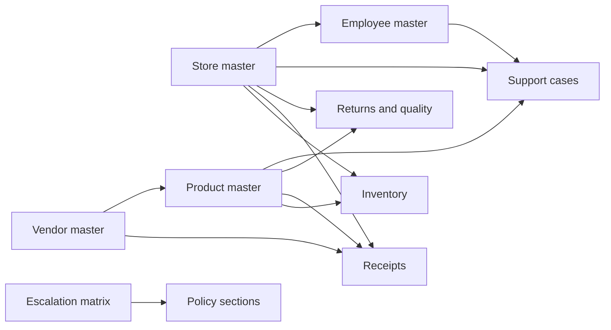

# Retail Data Analysis

Reviewed: 10 October 2026. Scope: all nine business CSVs, both evaluation CSVs, and the supplied operating policies. This is a planning document; source data and application implementation were not changed during the review.

Subsequent product decision: the app is StorePilot. Overview and Analytics are combined into Dashboard; Copilot reports issues and generates persistent tickets. The confirmed visibility rule uses the supplied numeric levels: creator current level <= viewer current level. RAG evaluation remains backend-only. The source-data findings below remain unchanged; PRD.md and TICKET_DATA_MODEL.md govern the revised product.

## What the data represents

The package supports a retail operations copilot for a sports-goods chain. Its main purpose is to connect a reported problem to stock, deliveries, vendor context, returns, and a documented escalation route. It supports incident triage and operational investigation.

The repeated descriptions, almost balanced case categories, systematic product names, and employee names such as `Employee 001` suggest a generated challenge dataset. This is an inference from the records. Its distributions should not be presented as representative of a real retailer's performance.

There are **2,970 business records** across nine tables. The evaluation directory is separate: 11 public test cases and 12 prediction-column definitions.

## Dataset inventory

| Source | Rows | Meaning and useful role |
| --- | ---: | --- |
| `data/store_master.csv` | 50 | Location directory: 49 stores and warehouse `WH001`, across six regions. Register counts, average traffic, and a nearby-location reference provide context. |
| `data/product_master.csv` | 520 | Product catalogue: names, merchandise categories, current vendor, list price, handling attributes, warranty, and high-demand flag. 136 products are marked high-demand. |
| `data/vendor_master.csv` | 15 | Vendor summaries: fill rate, on-time rate, effective date, and status. Five are marked `Watch`, ten `Active`. These are supplied summary measures, not calculations from all receipts. |
| `data/employee_master.csv` | 100 | Employee directory with role, assigned location, and escalation level. The employees cover only seven of the 50 locations. Numeric escalation levels have no supplied authority definition. |
| `data/inventory.csv` | 1,250 | Stock observations keyed by location and SKU: physical on-hand quantity, system quantity, reorder point, count date, and shelf capacity. This is a sparse snapshot, not stock history. |
| `data/receipts.csv` | 310 | Purchase receipts: ordered and received quantities, actual vendor, receipt date, quality-check result, and damage notes. Useful for investigating short deliveries. |
| `data/returns_quality.csv` | 160 | Return and complaint records with reason, recorded refund amount, receipt availability, status, and notes. Not every return is a defect or a completed refund. |
| `data/support_cases.csv` | 550 | Reported issues and requests with timestamps, location, employee, text, optional SKU/register, historical category/priority labels, and status. Includes analytics requests as well as operational incidents. |
| `data/escalation_matrix.csv` | 15 | Trigger-based routing: priority, team, queue, SLA minutes, approval flag, and policy section. Eight routes explicitly require human approval. |
| `evaluation/public_test_cases.csv` | 11 | Prompts and expected behaviour for checking the copilot. Keep separate from runtime retrieval and model evidence. |
| `evaluation/predictions_schema.csv` | 12 | Definitions of output columns; these are schema rows, not cases or predictions. |

Product categories describe merchandise; support-case categories describe operational problems. They are different taxonomies.

## How the tables connect

For a stock issue, join inventory to the product, recent receipts for the same location/SKU, the receipt vendor, and related cases. For vendor quality investigation, returns and cases can be attributed through the product's current vendor, but that does not establish which vendor supplied the particular returned unit.

The escalation matrix joins to policies by file and heading reference. All 15 policy references resolve to supplied headings. It does not join to employee escalation levels, and routing teams do not always match employee role names exactly.

## Calculated operational findings

### Support workload

Use the required anchor **2026-10-10 12:00 IST**, rather than the machine clock. A rolling window is `(anchor - duration, anchor]`; unresolved means `Open` or `In Progress`.

| Measure | Result |
| --- | ---: |
| All support records | 550 |
| Records created by the anchor | 544 |
| Unresolved records created by the anchor | 407 |
| Unresolved P1 / P2 / P3 / P4 records created by the anchor | 14 / 94 / 241 / 58 |
| Unresolved P1/P2 records in the last 24 hours | 21 |
| Locations represented in that 24-hour result | 11 |

The 24-hour location counts are ST002: 4; ST001: 3; ST003, ST004, ST005, ST006, ST008: 2 each; ST017, ST029, ST033, ST041: 1 each.

These are counts using the supplied labels and status snapshot. They are not independently validated incident severities. The table includes requests for analytics, and there is no resolution timestamp with which to reconstruct historical status or calculate resolution time.

Six support records occur after the anchor. Keep them in the source but exclude them from calculations ending at the anchor. Two return records, `RQ-035` and `RQ-105`, also occur after it.

### Inventory

Across all 1,250 snapshot rows:

- 18 have zero physical on-hand quantity.
- 205 are at or below reorder point, including the zero-stock rows.
- 1,090 have different physical and system quantities; only one has an absolute difference greater than ten units.
- 11 show positive system quantity while physical on-hand is zero.

A quantity difference is not automatically severe. The policy also has a percentage threshold, but it does not define the percentage denominator; that calculation needs an explicit rule, including zero-quantity handling.

All 520 products appear somewhere, but only 1,250 of the 26,000 possible location/SKU combinations are supplied. Missing rows are **unknown availability**, not zero stock. Of 477 SKU-bearing support records, 415 have no matching inventory location/SKU row. Similarly, 292 receipts and 146 returns lack a matching inventory row. These are coverage gaps, not broken SKU references.

715 rows have on-hand quantity above shelf capacity. This alone does not prove invalid data: on-hand may include backroom stock, and warehouse storage has different semantics.

### Deliveries and vendors

Across all 310 receipts:

- 289 have received quantity below ordered quantity.
- 247 have receipt fill below 90%.
- 21 have `quality_check_ok = No`.
- Ordered units total 21,524; received units total 16,648.
- Quantity-weighted fill is **77.35%**, calculated as total received / total ordered.

| Vendor | Receipt rows | Observed quantity-weighted fill | Supplied master fill |
| --- | ---: | ---: | ---: |
| V001 — Jalandhar Willow Works | 40 | 61.92% | 68% |
| V004 — ProShield Equipment | 34 | 67.02% | 72% |
| V009 — Jalandhar Tennis Supplies | 31 | 68.70% | 88% |

These are investigation signals. Differences from vendor-master rates may reflect different periods, product mixes, or calculation methods. Six vendors have no receipts in the file; their observed fill is unavailable, not zero. Receipt dates do not include promised arrival dates, so the supplied on-time rates cannot be independently reconstructed.

### Returns and approvals

Across all 160 return records, including the two after the anchor:

- 108 are open and 52 closed.
- 41 have no receipt and therefore require manager review under the supplied policy.
- 85 have recorded refund amounts of at least INR 5,000.
- 38 have no receipt and amounts of at least INR 1,000.
- Accounting for overlap, 88 meet the explicit amount-based approval conditions; 91 require review or approval when all no-receipt records are included.

These flags identify policy requirements. They do not establish that approval is missing, a refund was paid, or a financial loss occurred. There is no approval audit or payment-status field.

## Connected scenarios the copilot can explain

### English Willow bats at ST002

`SKU1001` has physical stock 0, system quantity 4, and reorder point 10. Receipt `RCPT-001` delivered 18 of 50 units; `RCPT-002` delivered 20 of 45. Together that is 38 received against 95 ordered, or 40% fill. Vendor V001 has supplied fill 68% and on-time rate 82%. Related cases report shortages and false availability.

The evidence supports a likely link to incomplete deliveries plus an inventory discrepancy. It does not prove demand volume or vendor fault. The response should cite the records, recommend stock reconciliation and Supply Chain review, and apply the high-demand stock-out rule.

### Tennis Ball Pack at ST005

`SKU7001` has zero on-hand stock at both ST005 and warehouse WH001. The copilot can explain that warehouse replenishment availability is depleted too. It should check other locations before recommending a transfer and must not promise stock.

### Football quality and pricing

`SKU2003` has seam-split/deflation complaints at ST001 and ST006. Related receipts include failed quality checks and damaged-carton notes. Separately, ST005 has a shelf price of INR 899 versus a reported POS price of INR 1,099, a difference of INR 200.

These support two different workflows: product-quality investigation and pricing correction. A return caused by a price mismatch is not a product defect. Damage on receipt and later complaints suggest investigation, but no batch/lot linkage proves a common cause.

### Fitness equipment safety and refund review

ST006 cases describe a treadmill belt slipping with reported injury and an exercise-bike handlebar loosening during a customer trial. These require P1 safety handling and human escalation under the supplied policy.

ST004 has a no-receipt treadmill return for INR 24,999. The assistant can prepare the facts for manager approval; it cannot approve the refund. Safety handling and refund approval are separate decisions even when related to the same product.

## Data interpretation issues that affect the design

| Finding | Required design response |
| --- | --- |
| No duplicate primary keys or unresolved populated ID references were found. | Preserve IDs and use explicit relational joins. Structural integrity does not guarantee semantic consistency. |
| 25 records saying “Suspicious request for restricted customer data.” are labelled P3 (21) or P4 (4), while the security route requires P1. | Enforce deterministic safety rules. Do not treat historical priority labels as unquestioned ground truth or let them weaken refusal/escalation. |
| 494 case roles differ from employee-master roles; 538 case locations differ from employee-master assignments. | Preserve case context and current directory context separately. Do not infer authority, misconduct, or staffing coverage from these joins. Assignment history is absent. |
| Employee escalation levels map to role groups without a supplied hierarchy definition. | Route using the explicit matrix and policy. Do not infer that larger levels confer greater approval authority. |
| `RCPT-012` names V004 for SKU4001, whose product-master vendor is V010. | Preserve the actual receipt vendor and flag the difference. It may be alternate sourcing, historical sourcing, or an inconsistent record; no supplied history settles it. |
| `RET-020` asks for vendor analytics but has a Product Quality category and P2 label. | Distinguish requests from reported incidents before using case counts as complaint counts. |
| 67 of 70 POS cases and 66 of 69 vendor cases are closed, while all quality cases are unresolved. | Treat category closure comparisons as challenge-data patterns, not evidence of team performance. |
| 73 case SKUs, 475 register IDs, and 390 root-cause hints are blank. | Allow optional context; ask a targeted follow-up when needed. A root-cause hint is not a verified diagnosis. |
| The SOP and POS policy express different priority wording for multiple-register impact. | Distinguish degraded service from inability to process payments; surface a policy conflict when the situation remains ambiguous. |

## Why vendor-quality rankings need a definition

There are 140 return records within the last 30 days ending at the anchor, but reasons include wrong size, exchange, no receipt, and pricing mismatch. Counting all of them as defects would distort the result.

For illustration, counting only the explicit reasons `Quality complaint`, `Football seam split`, `Football lost air quickly`, and `Treadmill belt slipped during demo` yields 23 return records: V001 has 6, V003 has 5, V007 has 4, V009 and V010 have 3 each, and V005 and V008 have 1 each. That definition excludes other possibly relevant damage reasons and is not a final defect taxonomy.

Support cases add another evidence stream, but may overlap returns and include analytics requests. There is no shared case/return identifier, receipt linkage, or lot identifier to deduplicate them reliably. Display case and return counts separately, state the filter/window and current-vendor attribution, and avoid presenting a combined count as unique defects or a defect rate.

## What the proposed app can show

1. **Copilot:** accept an issue or operational question, check safety, retrieve policy, query relevant tables, explain evidence, propose actions, and show the human route when required.
2. **Dashboard summaries:** permitted ticket workload and filters, with source inventory/receipt context where relevant. Show the window, denominator, data mode, and snapshot dates.
3. **Dashboard Analytics:** an embedded agent answers narrower questions such as “Why is SKU1001 unavailable at ST002?” or “Which locations have unresolved high-priority tickets?” Ticket evidence and aggregates use the same employee-level visibility rule as the dashboard.

SQLite should answer structured counts and joins; Chroma should retrieve policy passages; LangGraph should coordinate safety, evidence retrieval, policy application, and response composition. Historical labels, root-cause hints, and public expected answers should not be used to bypass independent reasoning or safety checks.

## What this data cannot establish

- Sales revenue, profit, actual units sold, lost sales, or reliable demand forecasts: no sales transaction history or cost data is supplied.
- Vendor blame, actual defect rates, or batch-specific causality: attribution, exposure, and lot linkage are incomplete.
- Stock trends or the duration of a stock-out: inventory is a snapshot, not a movement ledger.
- Resolution times or SLA compliance: closure and response timestamps are absent.
- Whether a refund was paid, an approval was granted, or a transfer/claim was executed: workflow audit records are absent.
- Authentication, current staff permissions, or approval authority: employee directory fields do not define those controls.

## Verification

Read every row of all nine business CSVs and both evaluation CSVs. Checked primary-key uniqueness, populated foreign references, optional blanks, timestamps, inventory coverage, and cross-table consistency. Independently reconciled support, inventory, receipt, and approval counts against the existing SQLite database through a read-only connection. SQLite foreign-key checks returned no violations. Verified all escalation policy headings. Sources remained unchanged.
