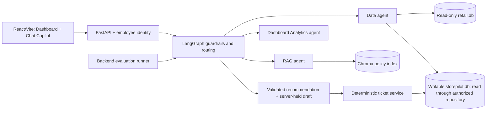
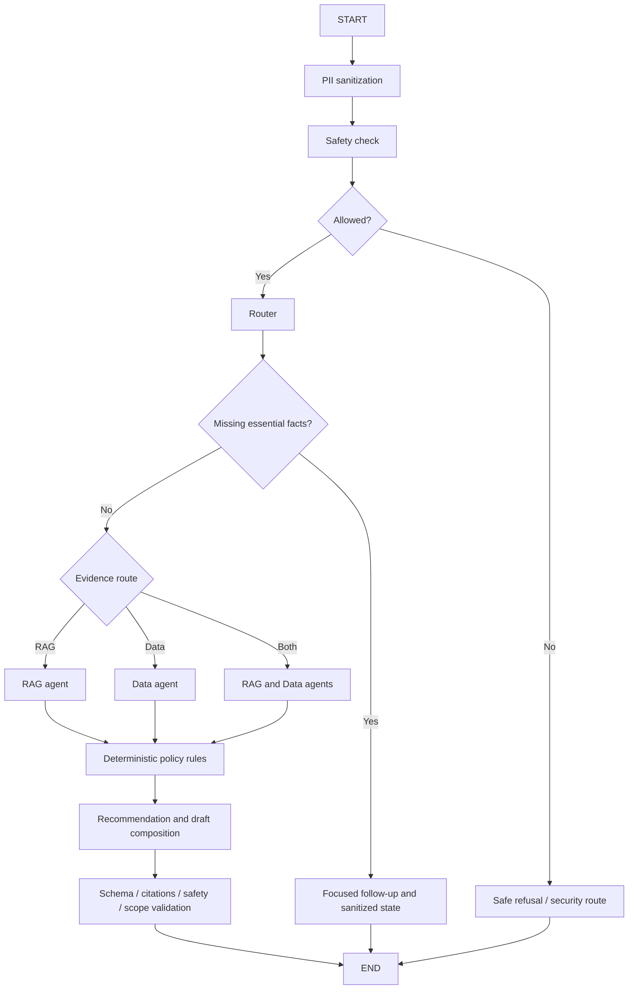

# StorePilot — System Design

Version: 2.0 | Status: proposed architecture; implementation paused

## 1. Architecture



All model calls, identity checks, authorization, retrieval, SQL, and persistence stay in FastAPI. LangGraph executes typed bounded workflows. Chroma is private to the backend. Tickets are persisted application records; models have no direct SQL/write or filesystem authority.

## 2. Agent contracts

| Agent/node | Responsibility | Output and limit |
| --- | --- | --- |
| PII agent | Sanitize every new message, draft edit, retrieved text, and outgoing result | Masked text and redaction flags; raw sensitive text is not persisted or checkpointed |
| Safety agent | Detect malicious/restricted intent and injection after sanitization | Allow/refuse, safe risk flags, security route; can block ordinary retrieval |
| Router agent | Classify intent, extract entities/impact, identify missing facts, select RAG/Data/Both | Validated route enum and evidence plan; does not execute tools |
| RAG agent | Retrieve relevant policy sections from Chroma | Bounded sections with valid source IDs; vectors are not operational facts |
| Data agent | Execute registered read-only query templates | Structured evidence; every ticket query is employee-scoped before aggregation |
| Analytics agent | Interpret dashboard questions and produce grounded analytic answers | Typed plan through Data, optional RAG, table/chart data and caveats; no incident creation |
| Response/rules nodes | Enforce priority/escalation; compose and validate | Recommended steps, concise explanation, follow-up or validated draft |
| Ticket service | Save reviewed server draft, enforce identity/idempotency, record events | Atomic persistent ticket receipt; deterministic service, not model authority |

The PII boundary must redact cards/secrets before any external intent model while retaining a safe flag such as payment-data-request. Safety can inspect the transient ingress input using local deterministic detection but must not log/store it. Implement these responsibilities as separate cooperating LangGraph nodes; agents may contain deterministic checks as well as bounded model calls.

## 3. Issue-report graph



Policy-backed actions require RAG evidence even if the router initially proposes Data-only. Pure factual queries can use Data-only. Clarifications return to the employee; the next turn starts with PII and Safety again. Urgent safe escalation guidance precedes optional follow-up questions.

State: request/conversation IDs, sanitized message history, viewer employee ID, access-context version, intent/route/entities, missing facts, risk flags, policy chunks, scoped data evidence, category/priority/confidence, draft revision, and validated response. Do not serialize secrets or unrestricted raw records into checkpoints.

Follow-up history is owner-only. Ticket detail may expose the sanitized report and evidence, not arbitrary private conversation turns. Changes in employee level or source version invalidate cached evidence and trigger scope revalidation.

## 4. Dashboard Analytics graph

Dashboard questions pass through the same PII -> Safety -> Router entry. The Analytics agent selects a supported intent and filters, calls Data for authorized queries, and optionally RAG for policy explanations. Shared final validation rejects unsupported evidence/citations and applies output masking.

Examples: unresolved tickets by store/window, category/priority counts, related visible tickets for a SKU, receipt shortages, and vendor-quality signals. Aggregates, result rows, explanation, drill-downs, and counts share the same visibility scope. Model context must never contain hidden tickets whose summaries could leak later.

Do not run free-form model SQL. A registered query template accepts validated parameters and server-controlled employee identity. Apply authorization before aggregation, pagination, joins, text search, and truncation. Row caps affect returned detail, not the correctness of requested aggregates.

## 5. Employee-level authorization

Confirmed rule: creator's current employee_master.escalation_level <= viewer's current employee_master.escalation_level. Use the existing numeric ordering, not a role-derived hierarchy and not P1–P4 priority.

Authorization is a mandatory repository predicate. Current levels are looked up for each request; creation-time level snapshots are retained for audit only. Missing directory entries/levels deny access. Reject client-supplied level/creator overrides. A ticket's assignee or escalation route does not bypass visibility.

Illustrative query on the application connection with retail.db attached read-only as retail:

```sql
WITH visible_tickets AS (
    SELECT t.*
    FROM tickets AS t
    JOIN retail.employee_master AS creator
      ON creator.employee_id = t.created_by_employee_id
    JOIN retail.employee_master AS viewer
      ON viewer.employee_id = :viewer_employee_id
    WHERE creator.escalation_level <= viewer.escalation_level
)
SELECT store_id, priority, COUNT(*) AS ticket_count
FROM visible_tickets
WHERE status IN ('Open', 'In Progress')
  AND created_at_utc > :start_utc AND created_at_utc <= :end_utc
GROUP BY store_id, priority;
```

For detail queries add ticket_id inside this authorized scope. Return the same generic not-found result for a nonexistent and an inaccessible ticket. No unrestricted ticket endpoint, source-case endpoint, or raw analytics fallback may bypass the rule.

Requested prototype identity: Employee ID + assigned Store ID -> directory-pair validation -> signed JWT. Verify fixed algorithm/signature, issuer/audience, expiry, session revocation, and current directory assignment on every protected request; fetch current levels separately. IDs are not secrets and do not prove the human owns the identity. REQUIREMENTS.md and API_CONTRACT.md define this flow; it is not implemented.

## 6. Storage boundaries

| Database/store | Purpose | Runtime access |
| --- | --- | --- |
| retail.db | Immutable typed import of all nine business CSV tables and import provenance | Read-only |
| storepilot.db | Conversations/messages, server-held drafts, tickets, evidence, idempotency and ticket events | Deterministic writes; scoped read-only agent tools |
| Chroma | Derived policy embeddings, bodies and citation metadata | Controlled indexing and backend retrieval |
| Evaluation artifacts | Predictions, metrics, retrieval checks and failures | Backend tests/CLI only |

Attach retail.db read-only where ticket joins need employee/store/product context. SQLite foreign keys do not span database files; service-level checks validate those logical references. Use normal SQLite foreign keys within storepilot.db and transactions for ticket child records.

Do not rebuild storepilot.db using the CSV importer. Application schema migrations and backup/recovery are separate from source import. Writable app-data and Chroma volumes persist across container recreation; source snapshot/policies are mounted read-only.

See TICKET_DATA_MODEL.md for fields, events, historical seeding, indexes, and transactional contracts.

## 7. Source-data semantics

Nine source tables remain intact with existing keys, indexes, and source hashes. Missing location/SKU inventory records mean unknown availability. Receipt vendor is the shipment vendor; current product vendor is not historical attribution proof. Support labels and root_cause_hint must not be copied into classifier evidence for the same issue.

Historical support cases may seed application tickets once. Preserve source_case_id, origin, recorded-label provenance, and creator employee ID. Separate source evidence from new application ticket evidence to avoid double counting the seeded record.

All related support-case evidence returned in employee mode must apply the same employee-level predicate. Return/receipt/inventory lookups are operational data under a separate allowlisted field policy, not a backdoor to hidden support tickets. Conversations are never general analytics input.

Quality reports distinguish visible support/application ticket signals from return records and state scope/definition. Without shared incident/batch IDs, do not claim a combined unique-defect count.

## 8. Policy retrieval and grounding

Split supplied Markdown policies by level-two section. Retain stable ID, filename, heading/slug, source ID, source lines, body, and hash. Index/query using the same explicit embedding model/configuration. Return at most four supporting sections with bounded required safety guidance.

Reindex through a controlled job when sources/configuration change. Do not index conversations, raw PII, operational tables, or evaluation expected answers. Reject missing/invented citation IDs; vector distance is not classification confidence. Provider/model settings remain in backend configuration.

Policies and the escalation matrix govern operational guidance. Ticket visibility levels do not define authority to approve refunds or transfers. A saved ticket may remain approval_pending without claiming the underlying action occurred.

## 9. Persistence lifecycle

Sanitized turn -> owner-only conversation/message save -> guardrail/router/evidence result -> validated server draft -> user Generate ticket -> ticket service rechecks identity/scope/version -> transaction saves ticket, steps, evidence/citations, creation event, and idempotent receipt -> commit -> response with ticket ID.

Classification/creator/routing fields come from the server, not client overrides. Material edits require reanalysis and a new draft revision. A retry with the same idempotency key returns the committed ticket, not a duplicate. If saving fails, do not display creation success.

Model/retrieval failures may preserve the sanitized issue but never invent grounded steps. P1 guidance can use verified deterministic policy rules and flag unknown evidence.

## 10. Time model

New application timestamps are actual UTC server timestamps and are displayed in IST. Live dashboard query windows end at a captured server-now instant. Fixed historical/evaluation anchor: 2026-10-10T12:00:00+05:30. Rolling intervals remain (start, end].

Evaluation queries the immutable source snapshot independently of app ticket status changes. No live ticket is discarded because it falls after the challenge anchor. Snapshot inventory count dates and date-only receipt limitations remain visible in provenance.

## 11. API and modules

FastAPI exposes identity/context, owner-scoped conversations/messages/drafts, authenticated tickets and dashboard metrics, and dashboard analytics. REQUIREMENTS.md defines contracts. No frontend evaluation route.

Proposed modules: agents/pii, safety, router, rag, data, analytics; graph/state and nodes; repositories/authorized_tickets and retail_queries; services/conversations, draft_validation, ticket_service, identity; retrieval/indexing; migrations/application; evaluation/runner. Existing scaffold has not implemented these modules.

## 12. Verification

Test all four visibility levels, direct-ID denial, aggregate/search/evidence scoping, client level spoofing, level-change/cache invalidation, private conversations, source-import survival, ticket-save rollback and idempotent retries, guardrails on follow-ups, safe P1 handling, supported queries, citation grounding, and pipeline evaluation without writes. Validate Docker persistence and frontend chat/dashboard error states during implementation.
